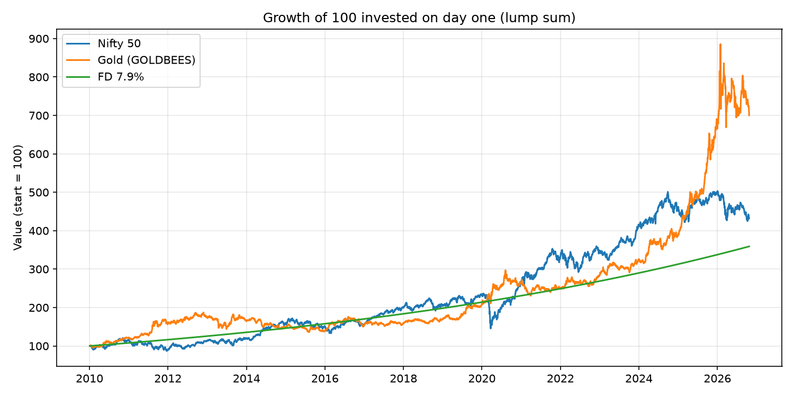
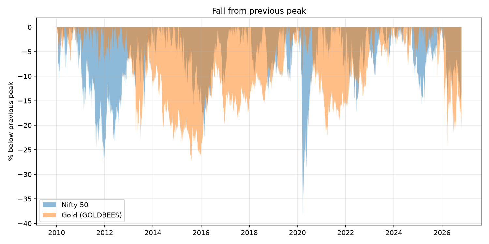
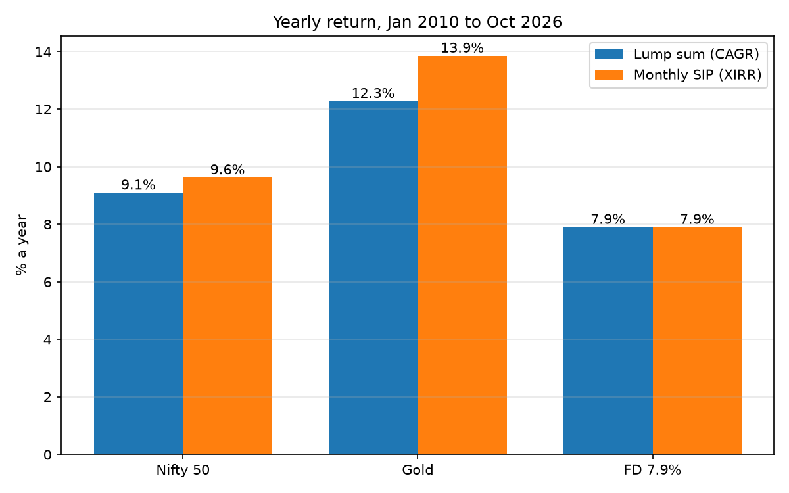

# SIP vs Lump Sum: Nifty 50, Gold and FD compared (2010 to 2026)

A Python project that compares investing Rs 5,000 every month (a SIP) with investing the same total in one go (a lump sum) in three places: the Nifty 50, gold and a fixed deposit (FD). It uses real price data from January 2010 to 23 October 2026 and measures yearly return and the worst fall along the way.

## Contents

- [The question](#the-question)
- [Key findings](#key-findings)
- [Charts](#charts)
- [How to read these results](#how-to-read-these-results)
- [Conclusion](#conclusion-what-this-does-and-does-not-tell-you)
- [Setup used in the comparison](#setup-used-in-the-comparison)
- [Metrics explained](#metrics-explained)
- [Worked example](#worked-example)
- [Data](#data)
- [Project structure](#project-structure)
- [Code reference](#code-reference)
- [How to run it](#how-to-run-it)
- [Testing](#testing)
- [Using a different end date](#using-a-different-end-date)
- [Known limits](#known-limits)
- [Learning notes](#learning-notes)
- [Disclaimer](#disclaimer)

## The question

Suppose you had money to invest in January 2010. You could put it all in on day one (lump sum), or spread it over monthly buys (SIP). And you could put it in:

- the **Nifty 50** index (data from yfinance, ticker `^NSEI`),
- **gold** (the GOLDBEES ETF, ticker `GOLDBEES.NS`),
- a **fixed deposit** at a fixed 7.9% a year, compounded yearly.

Which would have grown best?

This is harder than it looks. Lump sum money is invested for the whole period, while SIP money enters a little at a time, so simply comparing "money in" with "money out" is unfair. The project therefore uses yearly return measures (CAGR for the lump sum, XIRR for the SIP) and also measures the worst fall each investment went through (maximum drawdown). These are explained in the Metrics explained section below.

## Key findings

Window: January 2010 to 23 October 2026 (16.8 years). The SIP buys Rs 5,000 on the first trading day of each month: 202 buys, Rs 1,010,000 invested in total. The lump sum invests the same Rs 1,010,000 on day one.

| Investment | Lump sum yearly return | SIP yearly return | Max drawdown (worst fall from a peak) |
|---|---|---|---|
| Nifty 50 | 9.09% | 9.62% | -38.44% (trough 23 March 2020) |
| Gold (GOLDBEES) | 12.27% | 13.85% | -27.40% (trough 6 August 2015) |
| FD at 7.9% | 7.9% | 7.9% | none (fixed rate, no price to fall) |

Final values of the Rs 1,010,000 invested:

| Investment | Lump sum final value | SIP final value |
|---|---|---|
| Nifty 50 | Rs 4,362,601 | Rs 2,418,251 |
| Gold (GOLDBEES) | Rs 7,073,094 | Rs 3,656,940 |
| FD at 7.9% | Rs 3,626,131 | Rs 2,052,488 |

What the numbers show, for this window only:

- **Gold had the highest yearly return** in both forms, then the Nifty 50, then the FD.
- **The SIP had the higher yearly return** than the lump sum: by about 0.5 percentage points for the Nifty and about 1.6 points for gold. The lump sum ended with more rupees because all of its money was invested for the full 16.8 years, while SIP money was invested for about half that on average.
- **Against the FD:** the Nifty beat it by about 1.2 to 1.7 points a year, and gold by about 4.4 to 6 points.
- **Higher returns came with real falls.** The Nifty fell 38.44% from its peak at the worst point and gold fell 27.40%. The FD never fell.
- **Gold's lead held up in one stress test.** With the final gold price set 20% lower (all earlier prices unchanged), gold's yearly return was still about 10.8% for the lump sum and 11.6% for the SIP, above the Nifty and the FD. This tests one wrong final price only, not a different price path for 2026.

In this table, "yearly return" means CAGR for the lump sum and XIRR for the SIP; for the FD it equals the fixed rate by construction. "Max drawdown" is the largest fall from a previous high to a later low in the price.

## Charts

### Growth of 100 invested on day one (lump sum)



Read off the chart, 100 invested on day one ends at roughly 430 in the Nifty 50, 700 in gold and 360 in the FD. Gold climbs steeply from about 2024, peaks near 885 in early 2026 and ends near 700. The Nifty is clearly ahead of gold for most of about 2016 to 2024, and it dips sharply in early 2020.

### Fall from the previous peak (drawdown)



The Nifty's deepest fall is the sharp early-2020 crash (about -38%), apart from a stretch of about -27% around 2011 to 2012. Gold's deepest fall is around 2015 (about -27%), and it spent most of roughly 2013 to 2019 below an earlier peak: long, slow falls rather than sharp ones. In 2026 gold is about 20% below its peak.

### Yearly return by investment



The bars match the table above. Gold SIP is the tallest bar, and the order is gold, then the Nifty 50, then the FD, in both the lump sum and the SIP form.

## How to read these results

- **One window only.** All results come from one start date (January 2010) and one price path. Other windows could shrink or even flip these gaps, especially the SIP's edge. Read the result as "over this window", not as "SIP beats lump sum".
- **Different investors.** The lump sum puts Rs 10.1 lakh in on day one; the SIP puts in Rs 5,000 a month. Their rupee totals are not directly comparable, so lean on the yearly return column.
- **Gold's lead depends on the last two years or so.** In the growth chart, gold's lead over the Nifty appears to come mostly from about 2024 onwards, so a window ending earlier could show the Nifty ahead. This is read from the chart, not tested separately.
- **Why the SIP did better is a guess.** A plausible reason is that a SIP buys more units during falls and flat stretches (the early years, early 2020), but this was not tested against the data.
- **Gold's 2026 prices are unverified.** Gold's 2026 prices were not checked against a second source, and the gold results lean on them.

## Conclusion: what this does and does not tell you

For January 2010 to 23 October 2026, the answer to "which would have done better" is gold, then the Nifty 50, then the FD, in both the lump sum and the SIP form, with the Nifty and gold paying for it with falls of 38% and 27% along the way.

It does not tell you which will do better from here. Returns from one window cannot be turned into a forecast. The small hand examples worked out at the start of this project point the same way: the SIP did better when prices dipped, and the lump sum did better when prices only rose. Neither method wins in general. Which one suits you depends on the period you happen to invest in, how large a fall you can sit through, and whether your money arrives all at once or month by month.

Testing other start dates and rolling windows would be a natural next step. It is not part of this project.

## Setup used in the comparison

- **Buy price:** the daily Close.
- **SIP:** Rs 5,000 on the first trading day on or after day 1 of each month (the day is a parameter, `sip_day`, default 1). Units can be fractional. There are 202 buys from January 2010 to October 2026.
- **Lump sum:** the same total (202 x Rs 5,000 = Rs 1,010,000) invested at the first SIP buy price.
- **Valuation:** both are valued at the last Close in the data, 23 October 2026. The time span runs from the first buy date to that date, in days divided by 365 (16.811 years).
- **FD:** a fixed 7.9% a year (a parameter), compounded yearly. The lump sum FD is Rs 1,010,000 for the full span. The monthly FD treats each Rs 5,000 as its own FD from its buy date to 23 October 2026. This FD calculation lives in the notebook, not in `src/`.

## Metrics explained

**CAGR (compound annual growth rate).** The steady yearly rate that turns a start value into an end value: `(end / start) ** (1 / years) - 1`. For example, money that grows by 20% over 3 years has a CAGR of about 6.27% a year. CAGR suits a lump sum, where one amount goes in at one time.

**XIRR.** A SIP puts money in at many different dates, so CAGR on the total invested would be misleading. XIRR takes the dated cash flows (each payment as a negative amount, the final value as a positive amount on the last date) and finds the yearly rate that makes them add up to zero. This project solves for it by bisection, with time measured in days divided by 365. For a lump sum, XIRR and CAGR give the same answer (checked on the Nifty: both gave 9.0933%).

**Maximum drawdown.** The largest fall from a running peak to a later low, as a negative number. For the prices 100, 120, 90, 110, 130, the deepest fall is from 120 to 90, which is -25%. It describes how bad the worst stretch was, which yearly return alone hides.

## Worked example

Small enough to check by hand. Prices at three monthly buys: 100, 80, 120. Final price: 130. Rs 5,000 a month, so Rs 15,000 in total.

- **SIP:** 5,000/100 + 5,000/80 + 5,000/120 = 50 + 62.5 + 41.67 = about 154.17 units. Value: 154.17 x 130 = about Rs 20,041.67. Gain: about Rs 5,041.67.
- **Lump sum:** Rs 15,000 at the first price of 100 buys 150 units. Value: 150 x 130 = Rs 19,500. Gain: Rs 4,500.

The SIP wins here because the price dipped to 80 after the first buy. If the prices had only risen (100, 110, 120), the lump sum would win, because all of its money would have been in at the lowest price. The functions give the same numbers:

```python
from src.investing import lump_sum, sip

sip([100, 80, 120], 130, 5000)   # units about 154.17, final_value about 20041.67, gain about 5041.67
lump_sum(100, 130, 15000)        # units 150, final_value 19500, gain 4500
```

## Data

- **Source:** Yahoo Finance, through the `yfinance` library (version 1.7.0): `^NSEI` for the Nifty 50 and `GOLDBEES.NS` for gold. Only the daily Close is used.
- **Download range:** `start="2010-01-01"` and `end="2026-10-24"`. The end date is exclusive, so the last row is 23 October 2026. The end date is pinned so that results can be reproduced.
- **Size:** the Nifty file has 4,128 rows (4 January 2010 to 23 October 2026). The gold file has 4,146 rows from 4 January 2010.
- **Different trading days:** the two series do not have exactly the same dates (19 dates only in gold, 1 only in the Nifty file). Each series is run on its own dates.

| File | What it is |
|---|---|
| `data/raw/nifty50_close.csv` | Nifty 50 daily Close, exactly as downloaded |
| `data/raw/gold_close.csv` | GOLDBEES daily Close, exactly as downloaded (includes two wrong prices, see below) |
| `data/processed/nifty50_close_clean.csv` | Nifty 50 Close used in the analysis (same values as the raw file) |
| `data/processed/gold_close_clean.csv` | GOLDBEES Close used in the analysis, with the two wrong prices corrected |
| `data/processed/buy_prices_day1.csv` | The 202 monthly SIP buy dates and prices for the Nifty 50, with `sip_day=1` |

**The gold correction.** In the download, the GOLDBEES prices on 19 and 20 December 2019 were 100 times too small. The notebook multiplies those two prices by 100 in the processed file. The raw file is left untouched.

The data files are committed to the repository, so the results can be reproduced without downloading anything.

## Project structure

```
sip-vs-lumpsum/
├── README.md              this file
├── LEARNINGS.md           notes on what each stage taught
├── requirements.txt       pinned package versions
├── charts/
│   ├── growth_lump_sum.png
│   ├── drawdown.png
│   └── yearly_returns.png
├── data/
│   ├── raw/               downloaded data, untouched
│   └── processed/         cleaned data used in the analysis
├── notebooks/
│   └── 01_explore.ipynb   download, cleaning, comparison, summary table and charts
├── src/
│   ├── data.py            monthly_buy_prices
│   ├── investing.py       lump_sum, sip, fd
│   ├── metrics.py         cagr, max_drawdown, xirr
│   └── compare.py         run_asset (lump sum vs SIP on one price series)
└── tests/
    ├── test_data.py
    ├── test_investing.py
    ├── test_metrics.py
    └── test_compare.py
```

## Code reference

All functions are in `src/`. None of them charge fees, and units can be fractional.

| Function | File | What goes in | What comes out |
|---|---|---|---|
| `monthly_buy_prices(close, sip_day=1)` | `src/data.py` | A pandas Series of daily Close prices with a date index | A DataFrame indexed by month with columns `buy_date` and `price` (the first trading day on or after `sip_day`) |
| `lump_sum(buy_price, final_price, amount)` | `src/investing.py` | One buy price, the final price, the amount invested | A dict with `units`, `invested`, `final_value`, `gain` |
| `sip(buy_prices, final_price, monthly_amount, buy_dates=None, final_date=None)` | `src/investing.py` | A list of monthly buy prices, the final price, the monthly amount; optionally the buy dates and final date | A dict with `units`, `invested`, `final_value`, `gain`; with dates given, also `cash_flows` (a list of (date, amount) pairs for XIRR) |
| `fd(amount, annual_rate, years)` | `src/investing.py` | The amount, the rate as a decimal (0.079 for 7.9%), the years (may be fractional) | A dict with `invested`, `final_value`, `gain` (yearly compounding) |
| `cagr(start_value, end_value, years)` | `src/metrics.py` | Start value, end value, years | The yearly growth rate as a decimal |
| `xirr(cash_flows, tol=1e-10, max_iter=200)` | `src/metrics.py` | A list of (date, amount) pairs; `tol` and `max_iter` control the search | The yearly rate as a decimal, found by bisection |
| `max_drawdown(prices)` | `src/metrics.py` | A list or Series of prices in time order | The largest fall from a running peak as a negative decimal (-0.4167 means a 41.67% fall); 0.0 if the price never falls below an earlier peak |
| `run_asset(series, monthly=5000)` | `src/compare.py` | A price Series with a date index, the monthly amount | A dict with `months`, `years`, `invested`, `ls_final`, `ls_cagr`, `sip_final`, `sip_xirr` for one asset |

The functions raise `ValueError` on bad input (for example a zero or negative price or amount).

## How to run it

The project was developed on Windows with Python 3.14.4 and the package versions pinned in `requirements.txt`. The macOS and Linux commands below are the standard equivalents and have not been tested by the author.

**1. Get the code**

```
git clone https://github.com/itsAtharva30/sip-vs-lumpsum.git
cd sip-vs-lumpsum
```

**2. Create and activate a virtual environment**

Windows (PowerShell):

```
python -m venv .venv
.venv\Scripts\Activate.ps1
```

If PowerShell refuses to run the activation script, run `Set-ExecutionPolicy -Scope CurrentUser RemoteSigned` once and try again, or use Command Prompt and `.venv\Scripts\activate.bat`.

macOS or Linux:

```
python3 -m venv .venv
source .venv/bin/activate
```

**3. Install the packages**

```
pip install -r requirements.txt
```

The file was created on Windows with `pip freeze`. If one line fails to install on your system, remove that line and run the command again.

**4. Run the tests**

```
pytest -q
```

Expected: `29 passed`. One of the tests checks that the committed data gives the Nifty and gold numbers in the Key findings table, so it works as an offline check of the results.

**5. See the numbers for one asset (no notebook needed)**

Run this from the project root:

```python
import pandas as pd
from src.compare import run_asset

nifty = pd.read_csv("data/processed/nifty50_close_clean.csv", index_col=0, parse_dates=True).iloc[:, 0]
print(run_asset(nifty))
```

Expected: `months` 202, `invested` 1010000, `ls_cagr` about 0.0909 and `sip_xirr` about 0.0962. Use `gold_close_clean.csv` for gold (about 0.1227 and 0.1385).

**6. Open the notebook**

Open `notebooks/01_explore.ipynb` in VS Code with the Python and Jupyter extensions installed, and choose the `.venv` environment as the kernel. The notebook uses paths such as `../data/raw/...`, so it must run with the `notebooks` folder as its working directory (VS Code does this by default).

Run all cells from the top, in order. Some cells use variables created by earlier cells, so after a kernel restart run from the top again instead of running a single cell.

Two things to know before you run it:

- **It needs an internet connection.** The first cells download the data again from Yahoo Finance and overwrite the files in `data/raw` and `data/processed`. The end date is pinned, so the numbers should come out the same, but if Yahoo has revised its data they may differ slightly. The committed CSV files are the reference for the numbers in this README.
- **It overwrites the charts.** The chart cells save over the three PNG files in `charts/`.

The summary table cell prints, rounded to 4 decimals, `lump_cagr` and `sip_xirr` of 0.0909 and 0.0962 for the Nifty, 0.1227 and 0.1385 for gold, and 0.079 for the FD.

## Testing

Run `pytest -q` from the project root. There are 29 tests in four files:

- `tests/test_investing.py`: `lump_sum`, `sip` and `fd` on small hand-checked cases, and the errors for bad input.
- `tests/test_metrics.py`: `cagr`, `max_drawdown` and `xirr` on small hand-checked cases.
- `tests/test_data.py`: `monthly_buy_prices`, including the 202 monthly buys for the Nifty data.
- `tests/test_compare.py`: `run_asset` on a small made-up series, and a check that the committed Nifty and gold data give 9.09%, 9.62%, 12.27% and 13.85% (within a tolerance of 0.00006, because the numbers are stored to 4 decimals).

## Using a different end date

The committed results use data up to 23 October 2026. To try another end date (for example the latest trading day), work on your own branch so the committed data stays the reference.

1. Create a branch: `git switch -c my-window`
2. Open `notebooks/01_explore.ipynb` in VS Code with the `.venv` kernel. In the two download cells (the `^NSEI` one and the `GOLDBEES.NS` one), change `end="2026-10-24"` to the day after the last day you want. The end date is exclusive: `end="2026-10-24"` gives data up to 23 October, and `end="2026-10-29"` gives data up to 28 October. Leave `start="2010-01-01"` alone unless you want a different number of monthly buys.
3. Run all cells from the top (an internet connection is needed). The download cells overwrite the files in `data/raw` and `data/processed`, and the chart cells overwrite the PNGs in `charts/`.
4. Check the gold prices for 13 to 27 December 2019, which the cell after the gold download prints. The notebook multiplies the prices on 19 and 20 December 2019 by 100 because the original download had them 100 times too small. If your fresh download already shows normal prices on those dates, delete that multiplication in the cleaning cell.
5. In the FD cell, `total = 5000 * 202` assumes 202 monthly buys. That holds for end dates up to the first trading day of November 2026. After that, replace `202` with `len(monthly_buy_prices(nifty))`.
6. Expect differences. The numbers in this README will no longer match, the "Jan 2010 to Oct 2026" text in the chart titles will be out of date, and the real-data test in `tests/test_compare.py` (tolerance 0.00006 against the committed numbers) will probably fail. Do not push these changes to `main`.
7. To go back to the committed version: `git restore .` and then `git switch main`.

## Known limits

- **No fees, taxes or inflation.** The returns are before tax and before inflation, with no costs on any purchase.
- **Close prices only.** Dividends are not added separately. The Nifty 50 is an index and cannot be bought directly, while GOLDBEES is a traded fund whose price already carries the fund's own running costs.
- **The last month is partial.** The data ends on 23 October 2026.
- **The FD is an assumption.** The rate is fixed at 7.9% for the whole period and compounded yearly. Real FD rates changed over 16 years. The FD return equals the rate by construction.
- **XIRR convention.** Time is measured in days divided by 365.
- **Nifty is missing 7 trading days.** Nifty data from yfinance is missing 7 first-weekday January trading days (2012 to 2016, 2018, 2019). Nifty SIP buys for those months happen 1 to 3 days later than gold's. The effect on results is negligible (7 of 202 buys, about one day's price move each).
- **Gold price corrections.** The GOLDBEES prices on 19 and 20 December 2019 were 100 times too small in the download. They were multiplied by 100 in `data/processed/gold_close_clean.csv`; the raw file is untouched.
- **A possibly stale gold close.** The GOLDBEES close on 15 January 2026 equals the previous day's (possibly stale). It is not a buy date.
- **Gold's 2026 prices are unverified** against a second source.
- **Notebook cells depend on each other.** Some cells use variables from earlier cells, so the notebook should be run from the top.
- **Re-running the download cells.** The notebook's download cells fetch fresh data from yfinance and overwrite the committed CSV files in `data/raw` and `data/processed`. The committed files are the reference for the results above, and a fresh download may differ slightly.

## Learning notes

The project was built in stages: setup, finance by hand, data, core functions, metrics, comparison and charts, tests and refactor, and this write-up. `LEARNINGS.md` has notes on what each stage taught, including mistakes and how they were fixed.

## Disclaimer

This is a historical, educational comparison, not financial advice. Past returns do not predict future returns.

